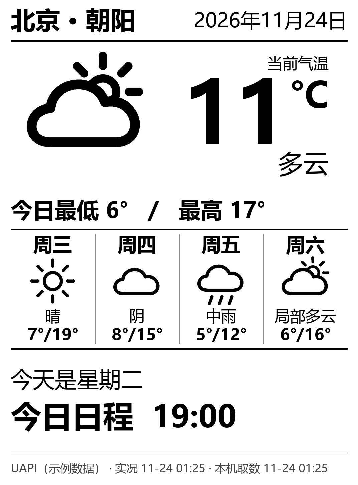

# Kindle PW3 壁挂天气与日程台历（Kindle PW3 Weather Wall）

把一台闲置的 **Kindle Paperwhite 3（第 7 代，固件 `5.16.2.1.1`）** 改造成真正可长期挂墙的墨水屏天气与日程台历：

* **启动一次，长期运行**：深度休眠时墨水屏保留最近一屏天气，**不跳原厂屏保**，到达整点自动唤醒联网刷新后再休眠。
* **极少系统改动，零修改只读根分区 `/`**：基于 WinterBreak2（`jb.sh v2.6.0+`）自带的 `sh_integration` 书库直启 `.sh` 脚本，**无需额外安装 KUAL、MRPI 或 USBNetwork**，不写 `/etc/upstart`，任何时候长按电源键 ~10 秒重启即可干净回到原厂阅读系统。
* **高对比度远距可读**：`1072 × 1448` 8 位灰度全刷 PNG（单帧约 60 KB，每小时刷新一次全天流量 < 1.5 MB），自研三次贝塞尔矢量天气图标，客厅沙发上清晰可读。
* **国内天气源优先 + 断网兜底**：优先拉取国内 UAPI（按行政区划 `adcode`），自动兼容 `"7 分钟前发布"` 等相对时间，并支持 Open-Meteo 多日预报补全与磁盘缓存；断网时 Kindle 保留上次画面不覆盖，底部清晰标注实况时间与本机取数时间。
* **适配动态家庭公网 IP 的访问控制**：服务端仅靠 32 位随机 `X-Wall-Token` 请求头鉴权，无令牌访问一律返回 `404`，无需频繁改云安全组白名单。

## 效果预览（脱敏示例数据）



## 架构概览

```text
[国内天气 API (UAPI) / Open-Meteo 兜底]
                 │
                 ▼
  Ubuntu 云服务器 (Python 标准库 + Pillow, ~25 MB 内存)
  └─ 独立端口 8088 + X-Wall-Token 鉴权 -> 实时渲染 1072×1448 灰度 PNG (~60 KB)
                 │
                 ▼  (每小时整点唤醒，curl 拉取单帧 PNG)
  Kindle Paperwhite 3 (5.16.2.1.1, jb.sh v2.6.0)
  ├─ 停原厂界面 (stop framework) + preventScreenSaver 1 + 关前光
  ├─ eips -c → sleep 1 → eips -f -g → sleep 3 (确保 EPDC 刷透再休眠)
  └─ 写 /sys/class/rtc/rtc0/wakealarm + echo mem > /sys/power/state 深度休眠
```

## 目录结构

| 路径 | 说明 |
| --- | --- |
| `server/weather_server.py` | 纯 Python + Pillow 渲染与 HTTP 服务，通过环境变量配置城市、坐标、周日程与访问令牌 |
| `server/kindle-wall.env.example` | 服务端配置模板（地区、坐标、每日日程、32 位随机令牌） |
| `server/kindle-wall.service.example` | systemd 托管模板 |
| `kindle/03-WeatherWall.sh` | 放入 Kindle `documents/` 的书库直启脚本（`sh_integration`） |
| `kindle/wall_worker.sh` | 后台常驻循环：联网取图、全刷保黑、RTC 定时休眠唤醒、断网保屏重试 |
| `kindle/config.example` | Kindle 端配置模板（服务端地址、令牌、刷新周期） |
| `scripts/prepare_anti_ota.py` | 越狱前将 Kindle 剩余空间压至 ~70 MB 的防自动升级工具 |
| `scripts/deploy_to_kindle.py` | 强制 Unix LF 换行并检查占位符的 Kindle 部署脚本 |
| `docs/RUNBOOK.md` | 从防升级、越狱、服务端部署到实机双周期验收的完整手册与踩坑记录 |

## 快速开始

详细步骤与每步排错请见 **[docs/RUNBOOK.md](docs/RUNBOOK.md)**，本地预览渲染效果只需一行：

```bash
pip install pillow
python3 server/weather_server.py --preview assets/preview-sample.png --sample
```

## 致谢与参考

* 硬件级休眠/唤醒与 PW3 5.16.2.1.1 面板参数核实参考了 [estcarisimo/paperwhite-weather](https://github.com/estcarisimo/paperwhite-weather)。
* 越狱与 `sh_integration` 机制来自 [KindleModding](https://kindlemodding.org/) 社区。

## 免责声明

越狱会修改你所拥有设备的软件，存在操作风险。本项目不分发亚马逊固件或越狱二进制文件，仅供学习与个人闲置设备再利用参考。
